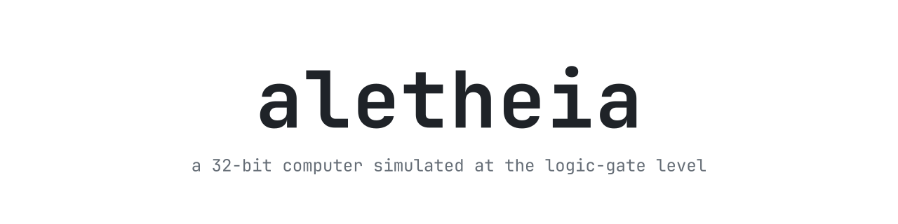
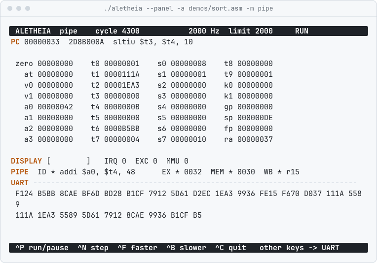

<p align="center">
  <picture>
    <source media="(prefers-color-scheme: dark)" srcset="docs/images/banner-dark.svg">
    
  </picture>
</p>

<p align="center">
  <a href="https://github.com/augustoflorentino/aletheia/actions/workflows/ci.yml"></a>
  <a href="https://github.com/augustoflorentino/aletheia/releases/latest"></a>
  <a href="LICENSE"></a>
</p>

<p align="center">
  <a href="#why-this-exists">Why</a> ·
  <a href="#what-it-does">What it does</a> ·
  <a href="#numbers">Numbers</a> ·
  <a href="#install">Install</a> ·
  <a href="#usage">Usage</a> ·
  <a href="#how-it-works">How it works</a> ·
  <a href="#development">Development</a> ·
  <a href="docs/api.md">API reference</a>
</p>

**A 32-bit computer simulated at the logic-gate level, in C, for anyone who
wants to watch a machine work, and then break it, one gate at a time.**

> [!NOTE]
> Version 0.9.0. The machine, the three cores and the attacks listed below all
> work and are tested. The library interface (`alt_`) may still change before
> 1.0; the changes are recorded in [CHANGELOG.md](CHANGELOG.md).

<p align="center">
  <picture>
    <source media="(prefers-color-scheme: dark)" srcset="docs/images/panel-dark.svg">
    
  </picture>
</p>

## Why this exists

This started with number theory. Some questions in my research kept circling
back to computation itself — to what a machine actually *does* with a number,
and to the von Neumann architecture I had used for years without ever looking
inside. I could have read my way to an answer. Instead I decided to rebuild the
thing in practice, and the smallest honest starting point was a simulator that
could multiply.

At first it was simple. But every answer opened another question, and the ones
that would not let go were about what I came to think of as *where data lives* —
the hiding place of information. Chasing that meant adding pieces: a register to
hold a value for one cycle, memory to hold it longer, addressing to find it
again, a cache to let it hide somewhere fast, an MMU to let one address quietly
become another. By the time I noticed, I was one component short of a whole
computer. Having come that far, finishing it was the only reasonable thing left
to do.

It was never meant to be the best, the most professional, or the solution to
anyone's problem. It came out of plain curiosity about logic gates, and it
stayed that way.

Finishing the computer did not end the curiosity, it moved it. *Where data
lives* turned into *how data leaks*: if every bit has a physical home, what
happens when the power is cut, a gate is broken, a device reads memory behind
the CPU's back, or someone watches how much the circuit switches? Answering
that changed what the project is for, from a computer you can read to a
hardware security lab you can break on purpose, with nothing hidden from you.

Simulators that run a MIPS-like ISA are easy to find, and so are HDL
toolchains that go down to gates. What I did not find was the two in one place
small enough to read: a whole computer whose every bit sits in a flip-flop you
can name, flip, starve of power or watch on a waveform, with no behavioural
shortcut between the instruction and the gate.

## What it does

- **ISA**: 32-bit, MIPS-like, 30 instructions: arithmetic and logic (`add`,
  `sub`, `and`, `or`, `xor`, `nor`, `slt[u]`, immediates, `lui`), shifts
  (`sll`, `srl`, `sra` and variable forms), `lw`/`sw`, `beq`/`bne`, `j`/`jal`/
  `jr`/`jalr`, `reti` and `halt`.
- **Three cores** running the same ISA: single-cycle, multi-cycle (FSM with
  IR/MAR/MDR) and pipelined (5 stages, forwarding, load-use stall, branch
  flush). All three are co-simulated against a reference instruction-set
  simulator (`ref/iss.c`).
- **Power and reset**: a power controller holds the machine in reset until the
  supply is stable; jumpers sampled at reset turn the L1/L2 caches and the MMU
  on or off and set the timer prescaler.
- **Memory**: SRAM of 256, 1024 or 4096 words, a 1K-word ROM, a DRAM that
  needs refresh and leaks without it, L1 and L2 caches, and an MMU (TLB plus a
  16-entry page table with a user bit).
- **Protection**: kernel and user mode. In user mode the MMU is forced on, and
  pages without the user bit, the MMIO page and `reti` all trap.
- **Exceptions and interrupts**: undefined instruction, address error and IRQ,
  each with its own vector; a timer raises the IRQ through a PIC with a mask
  register.
- **I/O**, memory-mapped at `0xFFFFFF00`: UART, GPIO, timer, PIC, an
  8-character display, a DMA engine and an expansion slot that can drive it.
- **Firmware**: a boot ROM that sizes and tests RAM, checks the timer and the
  UART, and drops into a monitor (`m` dump, `w` write, `g` go).
- **Fault injection**: flip any bit of the PC, a register or RAM at a chosen
  cycle (`-f`); tie one NAND gate to 0 or 1 for the whole run (`--stuck`); run
  63 machines at once, each with its own stuck gate, by bit-slicing every wire
  into a 64-bit word (`build/lanes`).
- **Physical attacks**: cold boot (`--power-off`, `--dram-leak`), power
  analysis from the state bits toggled per cycle (`--power`), and a DMA card
  that copies kernel memory past the MMU (`--dma-inject`).
- **Observability**: VCD waveforms of the bus, the pipeline and every register
  (`-w`), breakpoints, a live front panel (`--panel`), snapshots (`--save`,
  `--load`) and `--ref`, which compares a run against the reference model.
- **A library**: the whole machine as `libaletheia`, which is all the CLI
  uses.

## Numbers

Measured with `make bench` on 2026-11-15: AMD Ryzen 7 5700G, one thread,
gcc 16.2 `-O2`, `MEM=256`.

| Core   | NAND2 evaluated per cycle | Simulated cycles per second |
|--------|--------------------------:|----------------------------:|
| single |                   493,129 |                       3,091 |
| multi  |                   496,450 |                       2,882 |
| pipe   |                   499,932 |                       3,020 |

Cycles each core needs for the same program:

| Program          | single |  multi |   pipe |
|------------------|-------:|-------:|-------:|
| `demos/fib.asm`  |  7,076 | 25,591 | 10,146 |
| `demos/sort.asm` |  3,757 | 13,134 |  5,120 |
| `demos/pin.asm`  |    179 |    363 |    194 |

The method is `tools/bench.c`: the gate count comes from a build that records
every gate evaluated, the rate from 5,000 cycles of a small add, store and
load loop.

## Install

It needs a C11 compiler, `make` and, for the hardware check, Python 3. There
are no other dependencies. Linux is what it is tested on.

```sh
git clone https://github.com/augustoflorentino/aletheia
cd aletheia
make                              # ./aletheia
make MEM=4096                     # same, with 4096 words of SRAM
make install PREFIX=/usr/local    # libaletheia, the header and aletheia.pc
```

## Usage

```console
$ ./aletheia -a demos/fib.asm -c 200000 --ref
...
0 1 1 2 3 5 8 13 21 34 55 89 144 233 377 610 987 1597 2584 4181 6765 10946 17711 28657 46368 75025 121393 196418 317811 514229

Simulation finished.
Cycles executed: 7076
...
Reference model: 6964 instructions, halted
Reference check: match (0 differences)
```

```sh
./aletheia -a demos/sort.asm -m pipe -c 200000   # pick the core
./aletheia --boot                                # boot ROM and monitor
./aletheia --panel -a demos/sort.asm -m pipe     # the panel shown above
./aletheia -a demos/fib.asm -c 200000 -w fib.vcd # waveform for GTKWave
./aletheia --help                                # every option
```

Exit status: 0 halted, 1 error, 2 cycle limit reached, 3 breakpoint, 4
difference from the reference model.

Demos in `demos/`: `counter` (timer interrupts), `fib`, `sort`, `pin` (reads
a PIN over the UART), `dma`, `user` (user mode and its traps), `dmaattack` and
`coldboot`.

As a library:

```sh
make lib
cc app.c $(pkg-config --cflags --libs aletheia)
```

The interface is `include/aletheia/aletheia.h`, every name prefixed `alt_`. A
machine is an opaque `alt_machine_t`; you load a ROM, power it on, `alt_step`
or `alt_run` it and read its state. Faults, power cuts, DMA injection, traces,
snapshots and the reference check are all there, and each machine is
independent, so one process can run several. The full reference is in
[docs/api.md](docs/api.md).

## How it works

There is one rule: use nothing the hardware itself would not have on its way
down to silicon. The hardware (`core/`, `cpu/`, `memory/`, `bus/`, `io/`,
`system/`) is written in pure C with zero libraries, not even the C standard
library: only gates, wires, and the structures they form. Forbidden inside it:
`if`, `for`, `while`, `switch`, arithmetic and comparison operators. A
conditional is a multiplexer, a comparison is a comparator circuit, a loop is
unrolled or made sequential. Even the machine's own decisions (wait for power,
hold for DMA) come out of its signals, never out of C. `make check-compliance`
enforces it.

Everything around the hardware (the assembler in `isa/`, the simulator in
`simulation/`, the library in `api/`, the CLI in `cli/` and the tests) is
ordinary C11 with the standard library. That is the bench, not the machine.

Because the gates are the only primitive, swapping them changes what the
whole machine is: recorded, they give the netlist used for timing and gate
counts (`synth/`); with one of them stuck, a fault model; widened to 64 bits,
63 faulty machines running beside a healthy one.

## Development

```sh
make check       # everything the CI runs
make test        # hardware rules, then the test suite
make demos       # every demo on the three cores, outputs must match
make test-san    # the suite under ASan and UBSan
make lint        # format, hardware rules, API boundary
make help        # the rest
```

`make test-san SAN=undefined` runs UBSan alone, for kernels where ASan cannot
map its shadow memory.

## Contributing

Bugs and ideas go in the [issue tracker](https://github.com/augustoflorentino/aletheia/issues);
pull requests are welcome when `make check` passes. Security reports follow
[SECURITY.md](SECURITY.md).

## License

[MIT](LICENSE).

---

*P.S. — The hardware turned out well. I never did find what I came looking for.
Life is sad.*
